# LanCast

Compartilhamento de tela **local, de baixa latência**, pensado para jogar/assistir junto com amigos por VPN (Radmin).
Você transmite sua tela (ou só uma janela) e quem assiste abre um link no navegador. Sem conta, sem instalar nada do lado de quem assiste.

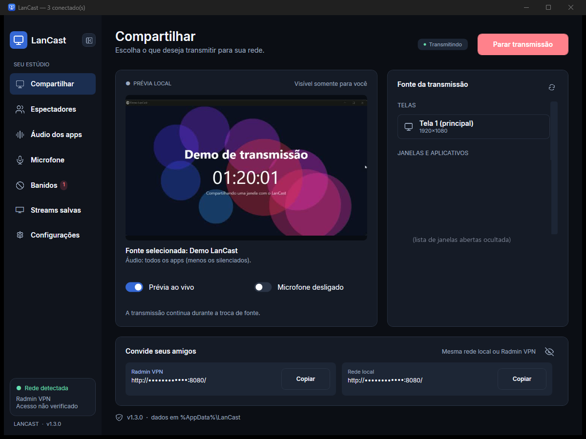

- **Vídeo:** H.264 por GPU (NVIDIA NVENC, com fallback para AMD, Intel e software) até 60 FPS.
- **Áudio:** Opus de 10 ms, com mixagem por aplicativo e microfone opcional.
- **Transporte:** WebRTC direto entre você e cada espectador (nenhum servidor na nuvem).
- **Quem assiste:** só precisa do Chrome ou Edge.
- **Visual:** menu lateral recolhível e seis temas (Escuro, Claro, Dracula, Nord, Solarized Dark e Monokai).

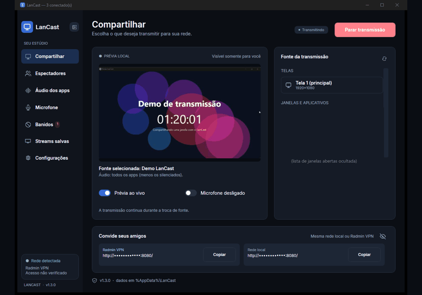

## Download

Baixe na página de [**Releases**](https://github.com/Guma325/LanCast/releases/latest):

| Modo | Arquivo | Para quê |
|---|---|---|
| **Instalador** | `LanCast-Setup-x.y.z.exe` | Instala em Arquivos de Programas, cria atalhos (Menu Iniciar / Área de Trabalho), libera o Firewall e adiciona desinstalador. |
| **Portátil** | `LanCast-Portable-x.y.z.exe` | Abre direto, sem instalar. Pode ficar em um pendrive. |

Os dois compartilham as mesmas configurações em `%AppData%\LanCast`.

**Requisitos:** Windows 10 2004 ou mais novo / Windows 11. GPU NVIDIA é o ideal (AMD, Intel e CPU também funcionam, com mais uso de processador).

## Como usar

1. Abra o LanCast. A transmissão começa com **Iniciar transmissão** (ou automaticamente, se você ativar essa opção nas Configurações).
2. Em **Convide seus amigos**, clique em **Copiar** no link da **Radmin VPN** e envie para os amigos. O link **Rede local** serve para quem está na mesma rede. O ícone de olho ao lado esconde o IP enquanto você transmite sua tela.
3. Quem assiste abre o link no Chrome/Edge, digita um nome e clica em **Assistir**.
4. Na primeira vez (modo portátil), aceite o aviso do Firewall do Windows ou use **Configurações > Liberar no Firewall**.

Fechar a janela só esconde o app na bandeja do sistema. Para sair de verdade, use o ícone da bandeja > **Sair**.

## Funcionalidades

### Menu lateral

Todas as telas ficam no menu à esquerda: **Compartilhar**, **Espectadores**, **Áudio dos apps**, **Microfone**, **Banidos**, **Streams salvas** e **Configurações**. O botão no topo do menu recolhe a barra para ganhar espaço, e o estado da transmissão e o botão **Iniciar/Parar transmissão** ficam sempre visíveis no alto da tela.

### Compartilhar: tela inteira ou só uma janela


- Escolha uma **tela** específica ou **só uma janela/aplicativo** em **Fonte da transmissão**.
- A **prévia local** mostra o que está sendo capturado (só você vê; ela não vai para os espectadores).
- Dá para trocar a fonte **durante a transmissão** sem derrubar ninguém. Se a janela fechar, o LanCast espera e volta sozinho quando ela reaparecer.
- **Convide seus amigos:** os links da Radmin VPN e da rede local, cada um com **Copiar**. O ícone de olho esconde ou mostra o IP (o **Copiar** continua copiando o link real), útil para não expor o endereço ao transmitir a própria tela. A escolha fica salva.

### Espectadores: quem está assistindo

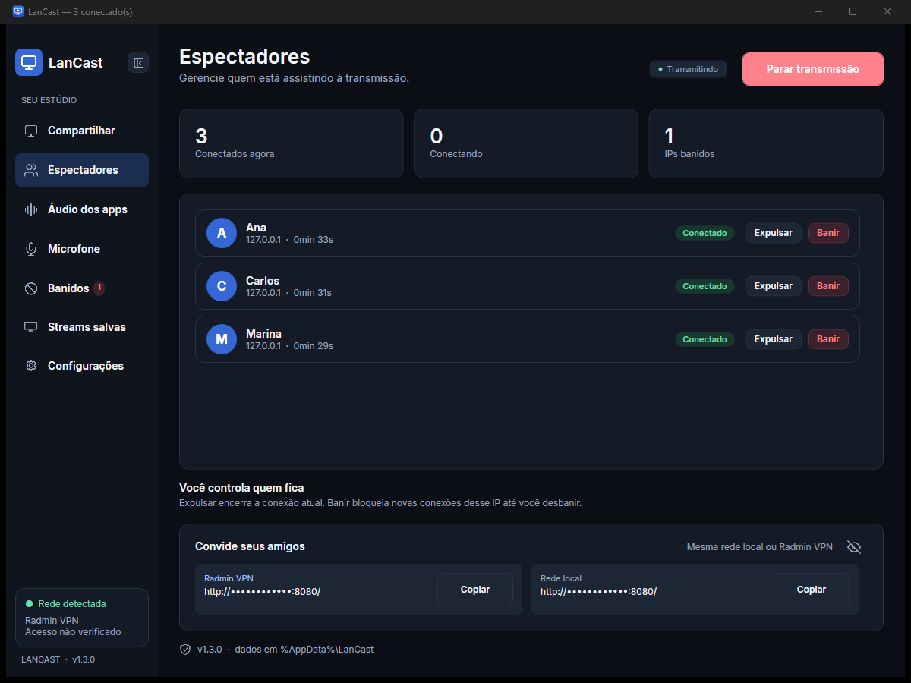

- Os contadores mostram quantos estão **conectados agora**, **conectando** e quantos **IPs estão banidos**.
- A lista traz o **nome** (escolhido por eles), o **IP** e o tempo de conexão.
- **Expulsar** derruba a pessoa (ela pode voltar). **Banir** bloqueia o IP dela.
- Senha opcional nas Configurações, caso queira restringir o acesso.

### O que o espectador vê

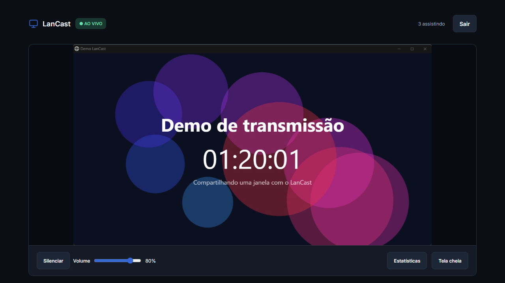

Uma página simples com o vídeo, o selo **AO VIVO**, o contador de quem está assistindo, **Silenciar** e volume (começa em 80%), **Estatísticas** (resolução, FPS, bitrate, latência) e **Tela cheia**. Se a conexão cair, aparece o aviso "Conexão perdida" e basta clicar em **Assistir** para reconectar.

### Áudio dos apps

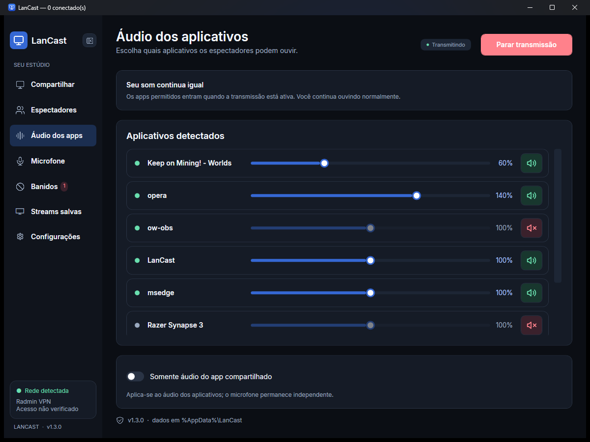

Cada aplicativo que já emitiu som aparece em **uma linha**: nome, barra de volume e botão de som.

- **Volume por aplicativo:** de 0% a 200%. Vale só para a transmissão, o som que você ouve não muda. O ajuste fica salvo para a próxima vez.
- **Botão de som:** verde com ondas = o app vai para a transmissão; vermelho com X = silenciado.
- Passe o mouse sobre a linha para ver o título da janela do app.
- **Somente áudio do app compartilhado** (embaixo) limita o áudio ao aplicativo da janela escolhida.

### Microfone

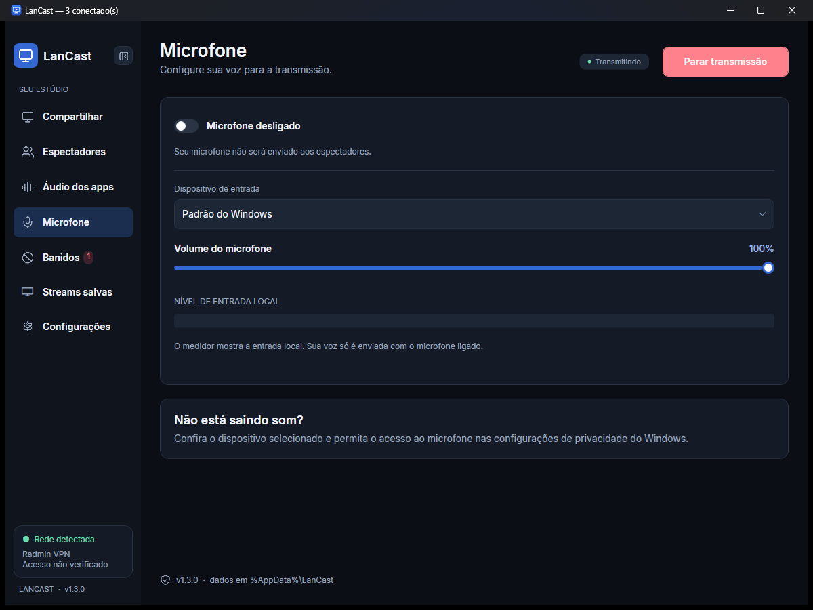

Liga e desliga o seu microfone na transmissão, com escolha de dispositivo, volume e medidor de nível local.

### Banidos

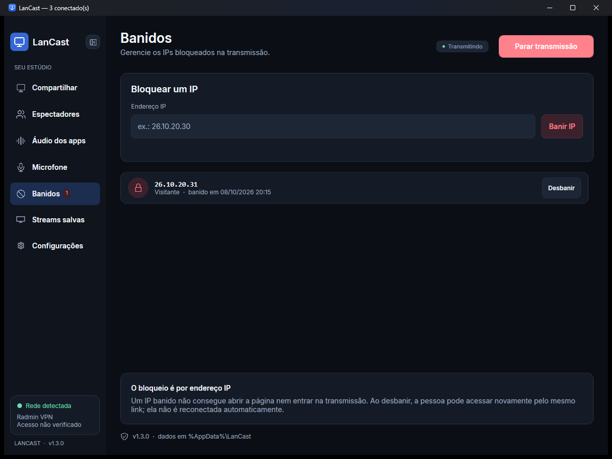

Lista de IPs banidos, com **Desbanir** e banimento manual por IP. Quem foi banido não consegue nem abrir a página. Na Radmin cada pessoa tem um IP fixo, então o banimento funciona bem.

### Streams salvas

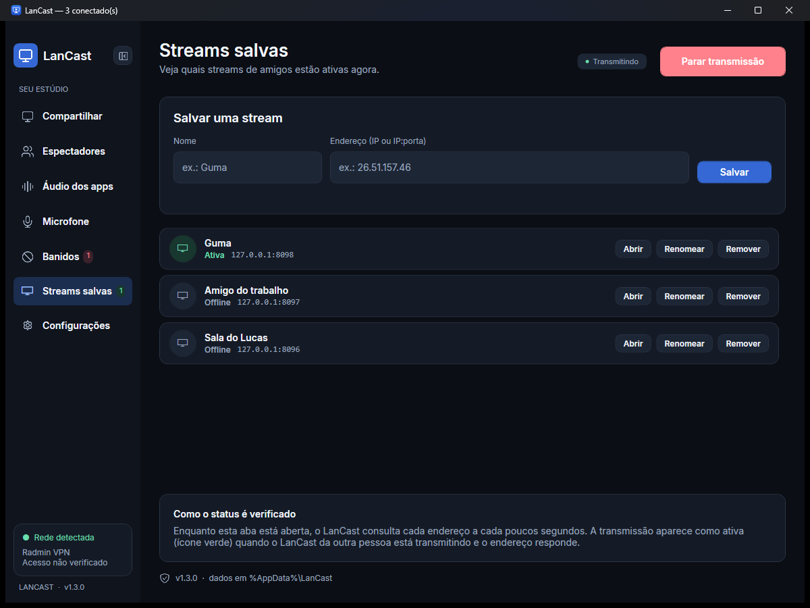

Guarde o endereço dos amigos que costumam transmitir e veja de relance quem está no ar.

- **Salvar:** informe um nome (ex.: "Guma") e o endereço, no formato `26.51.157.46`, `26.51.157.46:8080` ou o link completo. Sem porta, vale 8080.
- **Status:** o ícone fica **verde** e aparece "Ativa" (com o número de espectadores) quando o LanCast da outra pessoa está transmitindo; **Offline** em cinza quando não está. Um selo verde no menu mostra quantas estão ativas.
- **Abrir** abre a transmissão no navegador, **Renomear** edita o nome ali mesmo e **Remover** apaga da lista.
- O status é verificado a cada poucos segundos enquanto a aba está aberta.

### Configurações

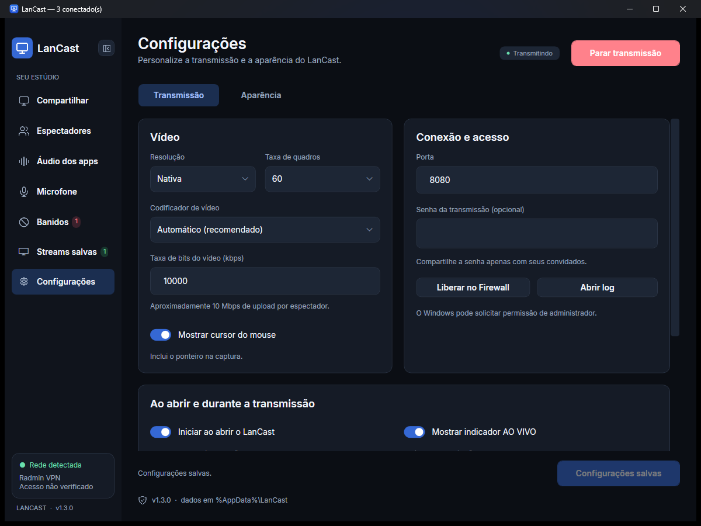

Na aba **Transmissão**: resolução, taxa de quadros, codificador de vídeo, bitrate, cursor do mouse, porta, senha opcional, **Liberar no Firewall**, **Abrir log**, iniciar ao abrir e o indicador **AO VIVO**.

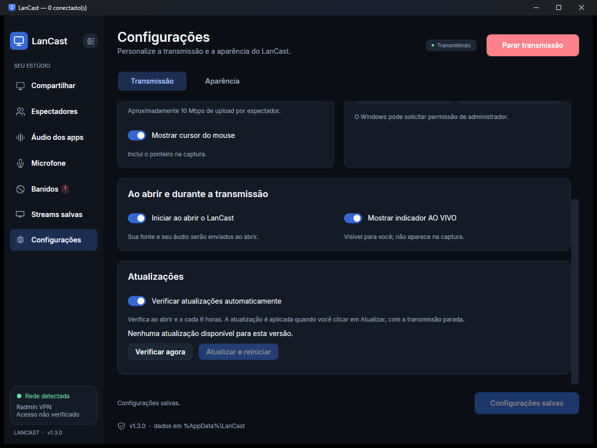

Mais abaixo ficam as opções de inicialização e as **Atualizações** (veja a seção abaixo).

Na aba **Aparência** você escolhe o tema, com prévia de cada um. A mudança é imediata e não interrompe a transmissão; **Restaurar padrão** volta ao tema Escuro.

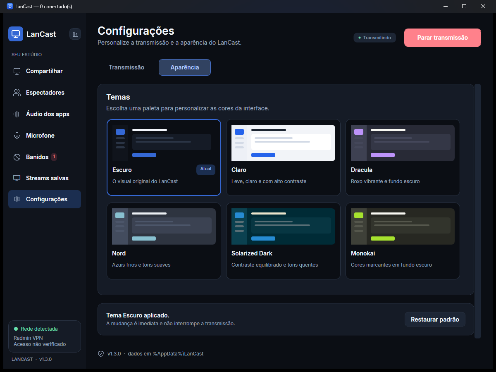

### Indicador AO VIVO

Para você não esquecer que está transmitindo (como o ponto vermelho do Android), enquanto a transmissão está ativa o LanCast mostra:

- uma **bolinha vermelha** no ícone da bandeja e no botão da barra de tarefas;
- uma **pílula vermelha "AO VIVO"** no topo da tela, com o número de espectadores.

A pílula não rouba o foco, deixa o mouse passar e **não aparece na transmissão**. Dá para desligá-la em **Configurações > Mostrar indicador AO VIVO**.

### Atualizações pelo aplicativo

Em **Configurações > Transmissão > Atualizações**, use **Verificar agora** e **Atualizar e reiniciar**.
Por padrão, o LanCast verifica novas Releases estáveis ao abrir e a cada 6 horas; essa verificação pode ser desativada.
O download e a instalação começam após a confirmação, com a transmissão parada. As configurações em `%AppData%\LanCast` são preservadas.
No modo instalado, o Windows pede permissão de administrador. No portátil, o executável é substituído no mesmo local, que precisa permitir gravação.
O download é validado pelo tamanho e pelo SHA-256 publicado pelo GitHub; arquivos sem esse hash não são executados.

Para distribuir atualizações, aumente `<Version>` no `.csproj`, rode `publish.bat` e crie uma Release pública estável com a tag `vMAJOR.MINOR.PATCH`.
Anexe **ambos** os arquivos gerados: `LanCast-Setup-x.y.z.exe` e `LanCast-Portable-x.y.z.exe`, com a mesma versão da tag.
Marque essa Release como a mais recente (**Latest**). Não basta enviar commits ou criar somente uma tag.
Quem usa uma versão anterior ao atualizador precisa instalar esta versão manualmente uma vez, por cima da instalação existente.

Validação do atualizador: `.\dev.cmd test` (testes locais, sem instalar ou baixar Releases reais).

## Se o vídeo ficar preto

O app tenta sozinho, em ordem: NVIDIA (NVENC) > AMD (AMF) > Intel (Quick Sync) > software (x264), e captura por GPU > CPU > GDI,
e fica no primeiro que realmente produzir vídeo. O método em uso aparece no cabeçalho ("Sem vídeo" em amarelo enquanto procura).
Se ainda falhar, abra **Configurações > Abrir log** (arquivo `%AppData%\LanCast\log.txt`, lista GPUs/drivers e erros do ffmpeg) e envie o arquivo.
Dá para forçar um codificador em Configurações > Codificador de vídeo.

## Limitações

- Perda de pacotes só se recupera no próximo keyframe (padrão 1 s).
- O banimento é por IP.
- O link usa o IP da Radmin (ex.: `http://26.x.x.x:8080/`). O LanCast não cria nomes de DNS.

## Para desenvolvedores

### Rodar localmente

Requisitos: Windows 10/11 e .NET 8 SDK (ou mais novo). Na raiz do repositório:

```powershell
.\dev.cmd setup   # confere o SDK, baixa o ffmpeg e restaura os pacotes (só na primeira vez)
.\dev.cmd run     # roda o app
```

Comandos do `dev.cmd`:

| Comando   | O que faz |
|-----------|-----------|
| `setup`   | Confere o .NET SDK, baixa o ffmpeg para `tools\ffmpeg.exe.gz` e restaura os pacotes. `-Force` baixa o ffmpeg de novo. |
| `build`   | Compila o app e os testes (`LanCast.sln`). |
| `run`     | Roda o app. |
| `test`    | Roda os testes do atualizador (`tests\UpdateChecks`). |
| `site`    | Serve a landing page em `http://127.0.0.1:4173`. |
| `publish` | Gera o portátil e o instalador em `dist\` (o mesmo que `publish.bat`). |

O `dev.cmd` só chama o `dev.ps1` ignorando a política de execução do PowerShell; se ela permitir scripts, `.\dev.ps1 <comando>` também funciona.

No Visual Studio, abra o `LanCast.sln` e aperte F5.

### ffmpeg

O LanCast embute o ffmpeg, que **não** está no repositório. O `tools\download-ffmpeg.ps1` baixa o build "release essentials" da [gyan.dev](https://www.gyan.dev/ffmpeg/builds/), confere o SHA-256 e gera `tools\ffmpeg.exe.gz`.
Se o arquivo não existir, a compilação roda esse script sozinha. Para usar outro ffmpeg, coloque o `ffmpeg.exe` em `tools\`, apague o `tools\ffmpeg.exe.gz` e rode `.\dev.cmd setup`: o script reaproveita o `ffmpeg.exe` existente.

### Landing page

A página de apresentação do LanCast fica em [`website/`](website/README.md). É um site estático, sem dependências de build: rode `.\dev.cmd site` e acesse `http://127.0.0.1:4173`. Para publicar na Hostinger, veja [website/README.md](website/README.md#hospedar-na-hostinger).

### Gerar os arquivos

Rode `publish.bat` (ou `.\dev.cmd publish`). Ele gera o portátil em `dist\portable\` e o instalador em `dist\installer\` (usa `tools\InnoSetup`, que acompanha o projeto).

### Versionamento

- A versão fica em `src\Host\LanCastHost.csproj` (`<Version>`); o `publish.bat` repassa para o instalador.
- Releases são tags git `vMAJOR.MINOR.PATCH` ([SemVer](https://semver.org/)); veja o `CHANGELOG.md`.
- Os `.exe` gerados **não** vão no repositório: ficam na página de **Releases**.

### Código (`src\Host`)

`ScreenEncoder` (ffmpeg ddagrab + NVENC -> RTP local), `AudioMixer`/`ProcessLoopbackCapture`/`MicCapture` (áudio por app + mic, Opus 10 ms),
`StreamHub` (WebRTC/SIPSorcery), `StreamService` (servidor web), `MainWindow` + `App.xaml` (WPF, com temas em `Themes/`), `LiveIndicator` (pílula AO VIVO), `AppVolumes` (volume por aplicativo) e `MainWindow.SavedStreams` (aba Streams salvas).
